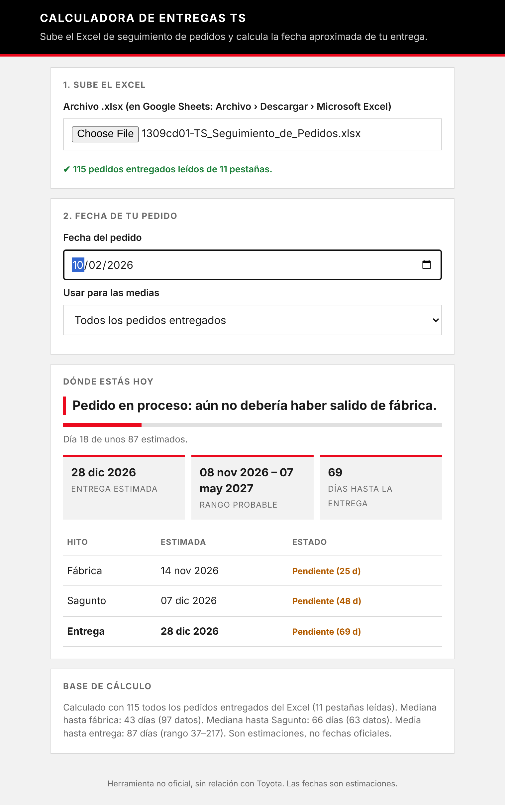
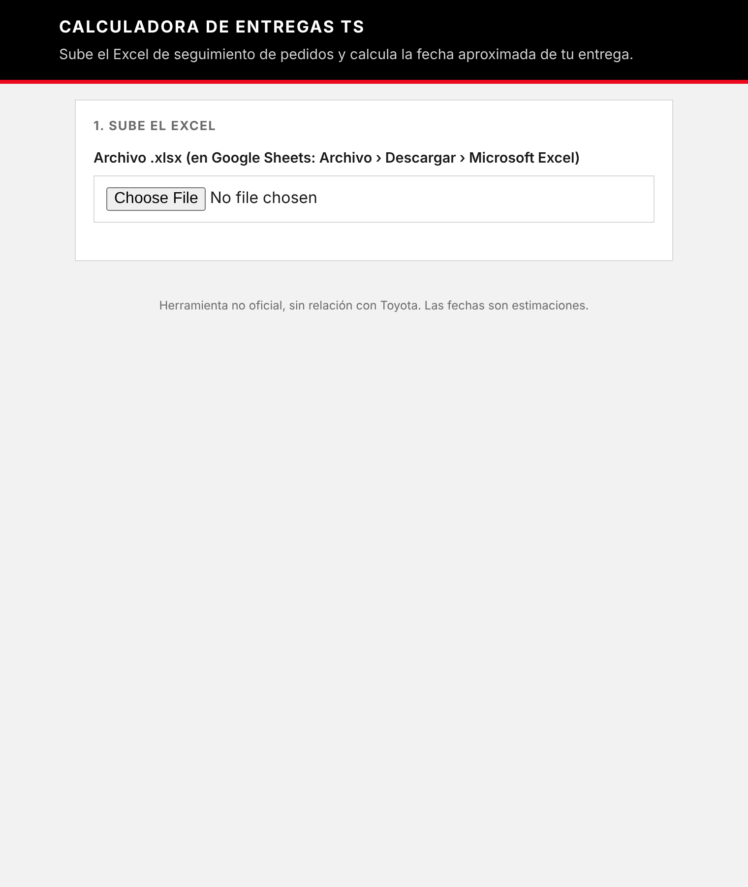

# Calculadora de entregas TS

Calcula la fecha aproximada de entrega de tu pedido a partir del histórico de pedidos del Excel de seguimiento.



## Qué hace

- **Lee todo el histórico**: recorre todas las pestañas de trimestre del Excel (de 4ºT 2023 a 3ºT 2026) y saca los pedidos ya entregados.
- **Calcula las medias**: tiempo hasta fábrica, hasta Sagunto y hasta la entrega, con su rango probable.
- **Te dice en qué fase estás hoy**: pedido en proceso, en tránsito, en Sagunto o entregado.
- **Te da las fechas estimadas** de fábrica, Sagunto y entrega, con los días que faltan.

Puedes elegir si las medias usan todos los pedidos o solo los de los últimos 12 meses.

## Descargar la calculadora

No hace falta instalar nada ni saber programar. Hay dos formas:

### Opción A: descargar el ZIP (la más sencilla)

1. Entra en el repositorio de GitHub: **https://github.com/loft17/TS-Entregas**.
2. Pulsa el botón verde **Code** y después **Download ZIP**.
3. Se descargará un archivo `TS-Entregas-main.zip`. Haz doble clic para descomprimirlo (en Windows: clic derecho › **Extraer todo**; en Mac, se descomprime solo).
4. Dentro de la carpeta encontrarás `calculadora_entregas.html`. Haz doble clic: se abrirá en tu navegador.

### Opción B: con Git (para quien ya lo usa)

```bash
git clone https://github.com/loft17/TS-Entregas.git
```

Después abre `calculadora_entregas.html` en el navegador.

### Opción C: sin descargar nada (si está publicada con GitHub Pages)

Si el repositorio tiene GitHub Pages activado, la calculadora se abre directamente desde un enlace: **https://loft17.github.io/TS-Entregas/**.

## Cómo se usa

1. Descarga el Excel de seguimiento de pedidos desde el foro de Club Toyota Corolla (ver [Créditos](#créditos)). Son los únicos archivos compatibles con la calculadora.
2. Abre `calculadora_entregas.html` en el navegador (ver sección anterior).
3. Sube el `.xlsx` en el paso 1.
4. Elige la fecha de tu pedido en el paso 2.

> **Importante:** cada vez que quieras una estimación actualizada, descarga de nuevo el Excel, porque la calculadora no se conecta a la hoja de Google.

### Problemas frecuentes

- **No aparecen los datos al subir el Excel:** comprueba que es un `.xlsx` (no un PDF ni una captura) y que las cabeceras de la hoja no se han cambiado.
- **Los estilos o el Excel no cargan:** la calculadora necesita conexión a internet para cargar la librería que lee el Excel.
- **Mac o Windows bloquean el archivo:** si el navegador avisa de un archivo descargado, confirma que lo abres tú a propósito.



## Privacidad

- El Excel **no se envía a ningún servidor**. Se lee dentro del propio navegador.
- La calculadora **no guarda nada**: cada vez que la abres, tienes que subir el archivo.
- No se muestran nombres de usuario, solo fechas.

## Limitaciones

- Las medias dependen del histórico. Si cambian los plazos de producción o de transporte, las estimaciones tardarán en reflejarlo.
- La lectura depende de que las cabeceras tengan los mismos nombres (`DÍA`, `USUARIO`, `FACTORY`, `SAGUNTO`, `ENTREGA`). Si alguien las renombra, esa pestaña se ignora.
- Se descartan las filas con fechas incoherentes (entrega antes del pedido, o más de un año de diferencia).
- Son **estimaciones**, no fechas oficiales.

## Requisitos

- Un navegador moderno con conexión a internet (para cargar la librería que lee el Excel desde cdnjs).

## Créditos

Los datos de seguimiento de pedidos son de la comunidad del foro **[Club Toyota Corolla](https://www.clubtoyotacorolla.com/)**. Gracias a quienes mantienen los Excel.

Los archivos que usa la calculadora están en estos hilos del foro:

- [Corolla HB: seguimiento de pedidos](https://www.clubtoyotacorolla.com/threads/corolla-hb-seguimiento-de-pedidos.8271/)
- [Corolla TS: seguimiento de pedidos](https://www.clubtoyotacorolla.com/threads/corolla-ts-seguimiento-de-pedidos.8272/)

## Aviso

Herramienta no oficial, sin relación con Toyota ni con el Club Toyota Corolla.
